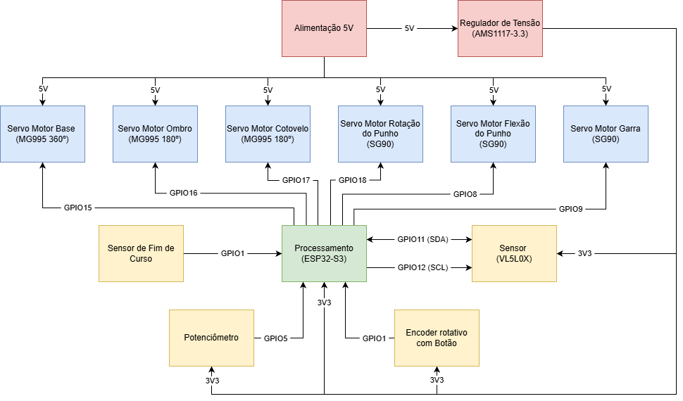
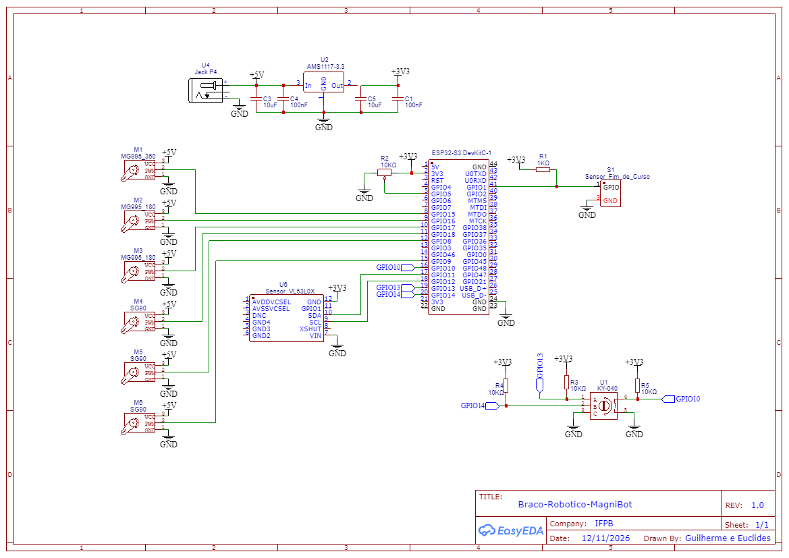
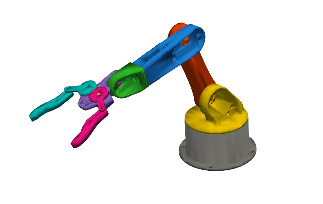

# Braço Robótico MagniBot

## Equipe:

- João Guilherme dos Santos Oliveira
- Euclides Benício Oliveira

## Diagrama de Blocos

Ferramenta utilizada: [Draw.io](https://app.diagrams.net/)

## Esquemático

Ferramenta utilizada: [EasyEDA](https://easyeda.com/)

## Representação do Digital Twin

